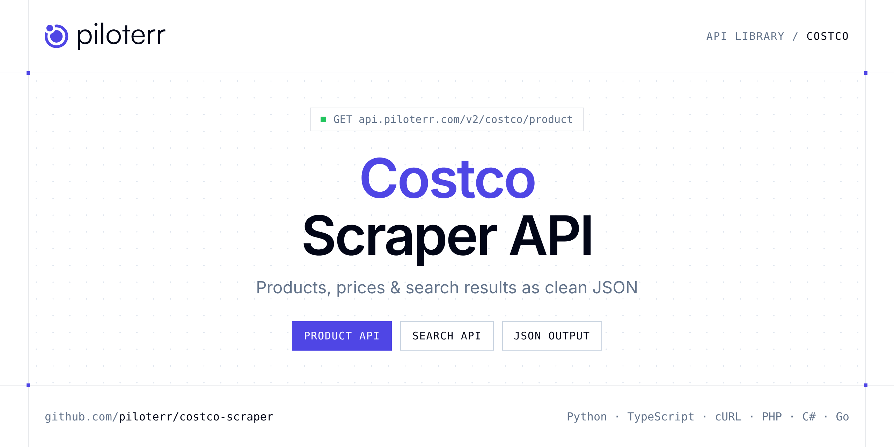

<p align="center">
  <a href="https://www.piloterr.com"></a>
</p>

# Costco Scraper API

[](https://discord.gg/CFj3ph8aHU) [](https://app.piloterr.com) [](https://app.piloterr.com/openapi) [](LICENSE)

The **Piloterr Costco Scraper API** lets you extract public data from Costco as **clean, structured JSON** — no proxies, headless browsers or HTML parsing to maintain. Endpoints available in production:

- **Costco Product API** — Costco Product API: fetch full product page data from a product ID or URL across regional Costco sites.
- **Costco Search API** — Costco Search API: search product listings by keyword or URL across 13 regional Costco sites.

Use it for price monitoring, assortment tracking, competitor analysis, product research or catalog enrichment.

| Endpoint | Path | Credits | What you get |
|---|---|---|---|
| [Costco Product API](#costco-product-api) | `/v2/costco/product` | 2 | Costco Product API |
| [Costco Search API](#costco-search-api) | `/v2/costco/search` | 2 | Costco Search API |

## Table of contents

- [How it works](#how-it-works)
- [Costco Product API](#costco-product-api)
- [Costco Search API](#costco-search-api)
- [Code examples in other languages](#code-examples-in-other-languages)
- [Practical use cases](#practical-use-cases)
- [Why Piloterr?](#why-piloterr)
- [FAQ](#faq)
- [Related scrapers](#related-scrapers)
- [Support](#support)

## How it works

1. **Create a free Piloterr account** and copy your API key from the [dashboard](https://app.piloterr.com).
2. **Send a `GET` (or `POST`) request** to `https://api.piloterr.com/v2/...` with the header `x-api-key: YOUR_API_KEY`.
3. **Receive structured JSON** — Piloterr handles rendering, proxies, retries and parsing.

```bash
export PILOTERR_API_KEY="your-api-key"
pip install requests        # Python
# TypeScript: Node.js 18+ (native fetch), run with `npx tsx file.ts`
```

> Every endpoint accepts both `GET` (query string) and `POST` (JSON body with the same fields).

## Costco Product API

Costco Product API: fetch full product page data from a product ID or URL across regional Costco sites. Returns pricing, availability, ratings, images and breadcrumbs via browser rendering.

`GET | POST https://api.piloterr.com/v2/costco/product` · **2 credits per request** · [Full reference](https://app.piloterr.com/openapi)

### Request parameters

| Parameter | Type | Required | Description |
|---|---|---|---|
| `query` | string | ✅ | Costco product ID or full product URL. |
| `region` | string | — | Regional Costco site. Accepts a region code (`us`, `fr`, `ca`, `uk`, …) or full host (`www.costco.fr`). Defaults to US (`www.costco.com`) when omitted. |
| `return_page_source` | boolean | — | When `true`, return the raw HTML page source as `{"result": "..."}` instead of structured JSON. Defaults to `false`. |

### Python example

```python
import json
import os
import requests

response = requests.get(
    "https://api.piloterr.com/v2/costco/product",
    headers={"x-api-key": os.environ["PILOTERR_API_KEY"]},
    params={
        "query": "4000266385",
    },
    timeout=60,
)
response.raise_for_status()
data = response.json()

print(json.dumps(data, indent=2, ensure_ascii=False)[:2000])
```

### TypeScript example

```typescript
type CostcoProduct = {
  url?: string;
  name?: string;
  brand?: string;
  price?: number;
  images?: string[];
  rating?: number;
  region?: string;
  currency?: string;
  image_url?: string;
  product_id?: string;
  breadcrumbs?: string[];
  description?: string;
  item_number?: string;
  availability?: string;
  review_count?: number;
};

const params = new URLSearchParams({
  "query": "4000266385",
});

const response = await fetch(`https://api.piloterr.com/v2/costco/product?${params}`, {
  headers: { "x-api-key": process.env.PILOTERR_API_KEY! },
});
if (!response.ok) throw new Error(`Piloterr error ${response.status}: ${await response.text()}`);

const data = (await response.json()) as CostcoProduct;

console.log(JSON.stringify(data, null, 2).slice(0, 2000));
```

<details>
<summary><b>POST variant</b></summary>

```http
POST https://api.piloterr.com/v2/costco/product
x-api-key: YOUR_API_KEY
Content-Type: application/json

{"query": "4000266385"}
```
</details>

### Output example

Example response from the API reference, abridged — real values depend on the page you scrape.

```json
{
  "url": "https://www.costco.com/p/-/mohawk-home-6mm-thick-94in-x-478in-22-mil-waterproof-luxury-vinyl-plank-flooring-1565-sq-ftctn/4000266385",
  "name": "Mohawk Home 6MM Thick 9.4in X 47.8in 22 MIL Waterproof Luxury Vinyl Plank Flooring (15.65 sq ft/ctn)",
  "brand": "Mohawk Home",
  "price": 47.99,
  "images": [
    "https://bfasset.costco-static.com/U447IH35/as/44xhpxq9ttr6nhpr4trsx53/4000266385-847_bloomingtonoak_1?auto=webp&format=jpg",
    "https://bfasset.costco-static.com/U447IH35/as/6wxn2893r8g35r5p98jnkw2v/4000266385-847_tudoroak_1?auto=webp&format=jpg&width=727&height=72…"
  ],
  "rating": 3.68,
  "region": "www.costco.com",
  "currency": "USD",
  "image_url": "https://bfasset.costco-static.com/U447IH35/as/44xhpxq9ttr6nhpr4trsx53/4000266385-847_bloomingtonoak_1?auto=webp&format=jpg",
  "product_id": "4000266385",
  "breadcrumbs": [
    "Home Improvement",
    "Flooring"
  ],
  "description": "SplashDefense® 100% Waterproof and Water-tight Joints;CleanProtect® Technology with Antimicrobial Properties Built in to Protect the Floo…",
  "item_number": "1806569",
  "availability": "in_stock",
  "review_count": 84
}
```

### Response fields

| Field | Type | Description |
|---|---|---|
| `url` | string |  |
| `name` | string |  |
| `brand` | string |  |
| `price` | number |  |
| `images` | string[] |  |
| `rating` | number |  |
| `region` | string |  |
| `currency` | string |  |
| `image_url` | string |  |
| `product_id` | string |  |
| `breadcrumbs` | string[] |  |
| `description` | string |  |
| `item_number` | string |  |
| `availability` | string |  |
| `review_count` | integer |  |

## Costco Search API

Costco Search API: search product listings by keyword or URL across 13 regional Costco sites. Returns prices, availability, review counts and pagination via browser rendering.

`GET | POST https://api.piloterr.com/v2/costco/search` · **2 credits per request** · [Full reference](https://app.piloterr.com/openapi)

### Request parameters

| Parameter | Type | Required | Description |
|---|---|---|---|
| `query` | string | ✅ | Search keyword or full regional search URL. |
| `region` | string | — | Regional Costco site. Accepts a region code (`us`, `fr`, `ca`, `uk`, …) or full host (`www.costco.fr`). Defaults to US (`www.costco.com`) when omitted. |
| `page` | number | — | 1-based page number override. Uses `currentPage` (most regions) or `page` (UK) when rebuilding pagination URLs. |
| `return_page_source` | boolean | — | When `true`, return the raw HTML page source as `{"result": "..."}` instead of structured JSON. Defaults to `false`. |

### Python example

```python
import json
import os
import requests

response = requests.get(
    "https://api.piloterr.com/v2/costco/search",
    headers={"x-api-key": os.environ["PILOTERR_API_KEY"]},
    params={
        "query": "home",
    },
    timeout=60,
)
response.raise_for_status()
data = response.json()

print(json.dumps(data, indent=2, ensure_ascii=False)[:2000])
```

### TypeScript example

```typescript
type CostcoSearch = {
  results?: {
    url?: string;
    price?: number;
    title?: string;
    region?: string;
    currency?: string;
    image_url?: string;
    product_id?: string;
    availability?: string;
    review_count?: number;
  }[];
  pagination?: {
    next?: string;
    page?: number;
    region?: string;
    per_page?: number;
    total_pages?: number;
    total_results?: number;
  };
};

const params = new URLSearchParams({
  "query": "home",
});

const response = await fetch(`https://api.piloterr.com/v2/costco/search?${params}`, {
  headers: { "x-api-key": process.env.PILOTERR_API_KEY! },
});
if (!response.ok) throw new Error(`Piloterr error ${response.status}: ${await response.text()}`);

const data = (await response.json()) as CostcoSearch;

console.log(JSON.stringify(data, null, 2).slice(0, 2000));
```

<details>
<summary><b>POST variant</b></summary>

```http
POST https://api.piloterr.com/v2/costco/search
x-api-key: YOUR_API_KEY
Content-Type: application/json

{"query": "home"}
```
</details>

### Output example

Example response from the API reference, abridged — real values depend on the page you scrape.

```json
{
  "results": [
    {
      "url": "https://www.costco.com/mohawk-home-6mm-thick-94in-x-478in-22-mil-waterproof-luxury-vinyl-plank-flooring-1565-sq-ftctn.product.4000266385.…",
      "price": 40.99,
      "title": "Mohawk Home 6MM Thick 9.4in X 47.8in 22 MIL Waterproof Luxury Vinyl Plank Flooring (15.65 sq ft/ctn)",
      "region": "www.costco.com",
      "currency": "USD",
      "image_url": "https://bfasset.costco-static.com/U447IH35/as/6wxn2893r8g35r5p98jnkw2v/4000266385-847_tudoroak_1?auto=webp&format=jpg",
      "product_id": "4000266385",
      "availability": "delivery",
      "review_count": 84
    }
  ],
  "pagination": {
    "next": "https://www.costco.com/s?keyword=home&currentPage=2",
    "page": 1,
    "region": "www.costco.com",
    "per_page": 24,
    "total_pages": 36,
    "total_results": 860
  }
}
```

### Response fields

| Field | Type | Description |
|---|---|---|
| `results[]` | object[] |  |
| `results[].url` | string |  |
| `results[].price` | number |  |
| `results[].title` | string |  |
| `results[].region` | string |  |
| `results[].currency` | string |  |
| `results[].image_url` | string |  |
| `results[].product_id` | string |  |
| `results[].availability` | string |  |
| `results[].review_count` | integer |  |
| `pagination` | object |  |
| `pagination.next` | string |  |
| `pagination.page` | integer |  |
| `pagination.region` | string |  |
| `pagination.per_page` | integer |  |
| `pagination.total_pages` | integer |  |
| `pagination.total_results` | integer |  |

## Code examples in other languages

Ready-to-run examples live in the [`examples/`](examples) folder. Each one reads your key from the `PILOTERR_API_KEY` environment variable.

| Language | Product | Search |
|---|---|---|
| cURL (Bash) | [`product`](examples/curl/product.sh) | [`search`](examples/curl/search.sh) |
| PHP | [`product`](examples/php/product.php) | [`search`](examples/php/search.php) |
| C# | [`product`](examples/csharp/Product.cs) | [`search`](examples/csharp/Search.cs) |
| Go | [`product`](examples/go/product.go) | [`search`](examples/go/search.go) |
| Java | [`product`](examples/java/ProductExample.java) | [`search`](examples/java/SearchExample.java) |
| Ruby | [`product`](examples/ruby/product.rb) | [`search`](examples/ruby/search.rb) |
| Node.js | [`product`](examples/nodejs/product.mjs) | [`search`](examples/nodejs/search.mjs) |

## Practical use cases

- **Price monitoring** — Track prices, promotions and availability over time to react to competitors.
- **Assortment & catalog tracking** — Follow new products, delisted items and category changes.
- **Competitor analysis** — Benchmark ranges, brands and positioning across retailers.
- **Product research** — Spot best-sellers and trends from search results.
- **Catalog enrichment** — Pull titles, images and attributes into your PIM or marketplace listings.

## Why Piloterr?

- **No infrastructure** — no proxies, headless browsers or CAPTCHA solving to run yourself.
- **Structured JSON** — stable, documented fields instead of brittle HTML selectors.
- **Pay per request** — transparent credit cost per endpoint, failed requests are retried for you.
- **One API key, hundreds of sources** — Costco plus many other e-commerce, search and company data endpoints in the [Piloterr library](https://www.piloterr.com/library).
- **Any language** — plain HTTPS + JSON, with examples for Python, TypeScript, cURL, PHP, C#, Go, Java, Ruby and Node.js.

## FAQ

### Is it legal to scrape Costco?

Collecting publicly available data is generally allowed in many jurisdictions, but rules depend on your country, the data you collect and how you use it. Avoid personal data unless you have a lawful basis, respect the website's terms where they apply, and get legal advice for your specific use case. This is not legal advice.

### Do I need proxies or a headless browser?

No. Piloterr handles rendering, proxy rotation and retries on its side. You only send an HTTPS request with your `x-api-key` header and receive JSON.

### How much does a request cost?

Credits per call: `/v2/costco/product` **2**, `/v2/costco/search` **2**. See the [Piloterr website](https://www.piloterr.com) for plans.

### What data does the Costco API return?

Each endpoint returns structured JSON: **Costco Product** — `url`, `name`, `brand`, `price`, `images`, `rating`; **Costco Search** — `results[]`, `results[].url`, `results[].price`, `results[].title`, `results[].region`, `results[].currency`.

### How do I paginate Costco results?

Use the `page` parameter and keep requesting while the response indicates more results.

### Can I target a specific country or language?

Yes, use `region` — see the parameter tables above for accepted values.

### Can I get the raw HTML instead of JSON?

Yes. Set `return_page_source=true` and the response becomes `{"result": "..."}` with the page source.

### Which languages are supported?

Any language that can make an HTTP request. This README shows Python and TypeScript; the [`examples/`](examples) folder contains cURL, PHP, C#, Go, Java, Ruby and Node.js.

## Related scrapers

- [About You Scraper API](https://github.com/piloterr/aboutyou-scraper)
- [Action Scraper API](https://github.com/piloterr/action-scraper)
- [Aldi Scraper API](https://github.com/piloterr/aldi-scraper)
- [Alibaba Scraper API](https://github.com/piloterr/alibaba-scraper)
- [AliExpress Scraper API](https://github.com/piloterr/aliexpress-scraper)
- [Allegro Scraper API](https://github.com/piloterr/allegro-scraper)
- [All Piloterr scrapers on GitHub](https://github.com/piloterr)

## Support

- 💬 Join the [Piloterr Discord](https://discord.gg/CFj3ph8aHU) to ask questions and share what you build.
- 📚 Browse the [API reference (OpenAPI)](https://app.piloterr.com/openapi) and the [Piloterr library](https://www.piloterr.com/library).
- 🔑 [Get your API key](https://app.piloterr.com).

---

<p align="center">
  <a href="https://www.piloterr.com">
    <picture>
      <source media="(prefers-color-scheme: dark)" srcset="images/logo-dark.svg">
      
    </picture>
  </a>
  <br>
  <sub>Built by <a href="https://www.piloterr.com">Piloterr</a> — web scraping APIs for e-commerce, search, real estate and more, one API key.</sub>
</p>

<sub>Costco is a trademark of its respective owner. This repository is not affiliated with or endorsed by Costco. Examples are released under the MIT license.</sub>
